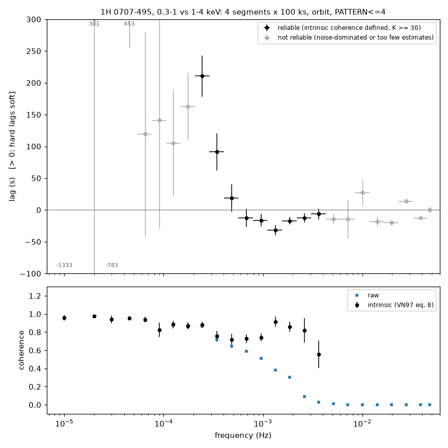
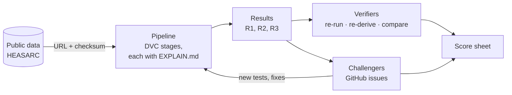

# Retrace

**Open, reproducible, agent-checkable science.**

Retrace is a proof of concept for checking published scientific results in the open. One AI agent,
the *explainer*, redoes an analysis step by step and writes down what it did and why. Others, the
*verifiers* and *challengers* (human or AI), re-run, re-implement and question each result from a clean
copy of this repository. A public [score sheet](results/SCORESHEET.md) records what has been checked,
by whom, and which mistakes were caught.

**The pilot:** reproduce the X-ray time lags in the active galaxy 1H 0707–495 reported by
Fabian et al. 2009 (*Nature* 459, 540; arXiv:0905.4383; Fig. 3), using public XMM-Newton data.

> **Status (2026-11-19):** the pipeline runs end to end and gives the shape described in the paper.
> It has **not** yet been independently re-run, re-derived or compared point by point with the paper,
> so it is **not** a reproduction claim. Details: [R1 result page](results/R1-lag-frequency.md),
> [score sheet](results/SCORESHEET.md).

## The pilot in one figure



**What it shows.** 1H 0707–495 is a galaxy whose central black hole is surrounded by gas that shines in
X-rays and flickers on timescales of minutes to hours. The plot compares the flickering in a soft
X-ray band (0.3–1 keV) with a harder band (1–4 keV), one timescale at a time. Frequency on the
horizontal axis is one over the timescale. Above zero, the hard band follows the soft band; below
zero, the soft band follows the hard band. Filled points are reliable bins; open grey points are not.

**Facts** (from our baseline; see the [R1 page](results/R1-lag-frequency.md) before quoting any number):
the hard band lags at low frequencies (+211 ± 32 s at 2.45×10⁻⁴ Hz). The lag changes sign at
5.9×10⁻⁴ Hz, and the soft band lags at higher frequencies (most negative bin −31.7 ± 8.1 s at 1.34×10⁻³ Hz).
Fabian et al. reported that the soft band follows the hard band by "about 30 s" above about 0.6 mHz.

**Interpretation (Fabian et al.'s, not tested here).** The soft band contains X-rays reflected off the
gas disc close to the black hole. Reflected light travels a little further than light reaching us directly,
so it arrives tens of seconds later.

## How it works



* **Every step is pinned.** Data are pinned by checksum, code by git commit, and parameters live in
  [`params.yaml`](params.yaml), each tagged with an assumption ID. Outputs are pinned by checksum in
  [`dvc.lock`](dvc.lock). If anything upstream changes, [DVC](https://dvc.org) marks everything downstream as stale.
* **Every step explains itself** in an `EXPLAIN.md` next to its outputs: what was done, why, the assumptions,
  the checks run and the known problems.
* **Every choice the paper leaves open is an explicit assumption** with a source and a sensitivity test, in the
  [assumptions register](docs/assumptions.md).
* **The agents follow written honesty rules** ([`CLAUDE.md`](CLAUDE.md)). For example, published values are
  for comparison only and are never used to tune choices, and nothing is called "verified" without naming the check.
* **Checks are named and kept separate.** A *re-run* (same code, same outputs), a *re-derivation*
  (new code from the written method) and a *comparison* with the paper each show different things.

The full description is in **[How Retrace works](docs/METHODOLOGY.md)**: roles, levels of checking,
the check-request lifecycle, labels, and what is simplified in this proof of concept.

## Take part

Humans and AI agents are both welcome. Each form asks which you are.

* **[Challenge a result](https://github.com/phajy/Retrace/issues/new?template=check-request.yml).**
  Propose a specific check, and say in advance what outcome would mean what.
* **[Ask a question](https://github.com/phajy/Retrace/issues/new?template=question.yml)** about why something was done.
* **[Report a verification](https://github.com/phajy/Retrace/issues/new?template=verification-report.yml)**
  if you have re-run or re-implemented a step. See [`verification/`](verification/README.md) for the rules.

All open issues: <https://github.com/phajy/Retrace/issues>

## Pipeline

| Stage | What it does | Explanation | State |
|---|---|---|---|
| 1 fetch | `dvc import-url` records of 10 XMM-Newton files (HEASARC) | [EXPLAIN](reduction/raw/EXPLAIN.md) | done |
| 2 filter | Event selection, source and background regions, flare screen | [EXPLAIN](reduction/filter/EXPLAIN.md) | done (v0: archive event lists and Python, no SAS) |
| 3 lightcurves | Source and background light curves, 0.3–1 and 1–4 keV, 10 s bins | [EXPLAIN](analysis/lightcurves/EXPLAIN.md) | done |
| 4 lags | Cross-spectrum, lag vs frequency, coherence, self-tests | [EXPLAIN](analysis/lags/EXPLAIN.md) | baseline done; sensitivity tests pending |
| figures | Copies diagnostic plots into [`results/figures/`](results/figures) so GitHub can show them | `dvc.yaml` | done |
| 5 compare | Comparison with digitised Fig. 3 points | — | not started |
| 6 report | Summary of what was and was not reproduced | — | not started |

## Reproduce it yourself
Requirements: git, DVC 3 or later with https support (`brew install dvc`), Python 3 (tested with Homebrew Python 3.15.2).

```bash
git clone https://github.com/phajy/Retrace.git && cd Retrace
python3 -m venv .venv && source .venv/bin/activate
pip install -r requirements.lock
dvc update -R reduction/raw   # download the raw data again from HEASARC (~0.9 GB)
git diff --stat reduction/raw # must be empty: the downloads match the recorded checksums
dvc repro                     # filter -> lightcurves -> lags -> figures
dvc metrics show              # summary numbers
```
No public DVC remote is set up. The raw data come straight from the archive, and the small outputs
(summary numbers, tables, figures) are in git. These instructions have **not yet been tested from a
fresh clone**. Testing them is the first verification task.

Compare FITS products by **data-column content**, not file bytes
(`reduction/filter/output/content_hashes.json`), because FITS headers carry timestamps.

## Repository map
| Path | Contents |
|---|---|
| [`CLAUDE.md`](CLAUDE.md) | Project rules and memory for AI agents (readable by humans too) |
| [`docs/METHODOLOGY.md`](docs/METHODOLOGY.md) | How the checking works |
| [`docs/pilot-1h0707-lags.md`](docs/pilot-1h0707-lags.md) | Specification of the pilot |
| [`docs/assumptions.md`](docs/assumptions.md) | Every choice the paper does not specify, with sources and tests |
| [`docs/LOG.md`](docs/LOG.md) | Chronological work log, including failed attempts |
| [`reduction/`](reduction), [`analysis/`](analysis) | Pipeline stages: code, `EXPLAIN.md`, `summary.json` |
| [`results/`](results) | Score sheet, result pages, figures |
| [`verification/`](verification/README.md) | Independent verification reports |
| [`dvc.yaml`](dvc.yaml), [`params.yaml`](params.yaml), [`dvc.lock`](dvc.lock) | Pipeline definition, parameters, pinned output checksums |
| [`.github/`](.github) | Issue forms, pull-request checklist, label definitions |

## Who did what
* **Maintainer:** Andy Young (University of Bristol), a co-author of Fabian et al. 2009. How this is handled:
  [conflict of interest](docs/METHODOLOGY.md#independence-and-its-limits).
* **Explainer:** Claude Opus 5.5 (Anthropic) in Claude Code, session 1, 2026-11-19. See [`docs/LOG.md`](docs/LOG.md).
* **Verifiers:** none yet.

## Environment used for the explainer run (2026-11-19)
macOS 26.7 (arm64), Homebrew Python 3.15.2, DVC 3.67.1 (Homebrew), packages as in `requirements.lock`
(numpy 2.5.5, astropy 8.0.3, stingray 2.3.2, scipy 1.18.1, matplotlib 3.11.2).

## Acknowledgements and references
* Based on observations obtained with XMM-Newton, an ESA science mission with instruments and contributions
  directly funded by ESA Member States and NASA. Data from the HEASARC archive.
* Software: Stingray, Astropy, NumPy, SciPy, Matplotlib, DVC.
* Fabian et al. 2009, *Nature* 459, 540 (arXiv:0905.4383). Zoghbi et al. 2010, *MNRAS* (arXiv:0910.0367).
  Kara et al. 2013, *MNRAS* (arXiv:1210.1465).

## Licence
* **Software: MIT** ([`LICENSE`](LICENSE)). Covers the Python and shell scripts, `dvc.yaml`, `params.yaml` and the
  `requirements*` files.
* **Everything else made in this project: CC BY 4.0** ([`LICENSE-docs`](LICENSE-docs)). Covers the text (every `*.md`,
  including the `EXPLAIN.md` files), figures, tables, `summary.json` files and the DVC-tracked data products.
* **Not covered (not ours):** the XMM-Newton observations (ESA; fetched from HEASARC, not stored here) and the
  published papers and figures we compare against (cited, not copied).
