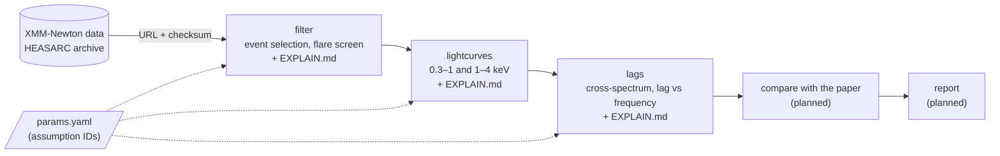
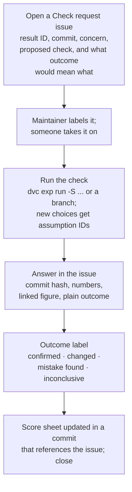

# How Retrace works

Retrace is a proof of concept for checking published science in the open, with AI agents and
humans in defined roles. This page explains the roles, how each result is tied to exactly what
produced it, what counts as a check, and how anyone can challenge a result through GitHub issues.

The rules every agent follows are in [`CLAUDE.md`](../CLAUDE.md). Claude Code reads that file
automatically at the start of every session, and it is written to be readable by people too.

## Roles

| Role | Who | What they do |
|---|---|---|
| **Explainer** | An AI agent (so far Claude Opus 5.5 in Claude Code) | Does each analysis step, then writes down what it did, why, which choices the paper left open, and which checks it ran. |
| **Verifier** | A human or an AI agent who is *not* the explainer | Starts from a clean clone and the written record only, re-runs or re-implements a step, and reports what happened. |
| **Challenger** | Anyone, human or AI | Opens a *check request* (a specific test of a specific result) or a *question* as a GitHub issue. |
| **Maintainer** | Andy Young | Merges changes, keeps the score sheet honest and settles disputes. |

One person or agent can hold different roles at different times, but never explainer and verifier
for the same result.

## The chain of trust

Each analysis step is a node with everything needed to re-run and judge it:

| Ingredient | Where it is pinned |
|---|---|
| Input data | Public archive URL plus checksum, recorded by `dvc import-url` (`reduction/raw/*/*.dvc`). We never store the raw data ourselves. |
| Code | Git commit. |
| Parameters | [`params.yaml`](../params.yaml). Every key is tagged with an assumption ID from [`assumptions.md`](assumptions.md). |
| Environment | [`requirements.lock`](../requirements.lock) (exact package versions) and the versions listed in the README. |
| Outputs | Checksums in [`dvc.lock`](../dvc.lock). FITS products are also hashed column by column, because headers can carry timestamps: the reference hashes are in git-tracked `content_hashes.json` files, and [`tools/fits_hashes.py`](../tools/fits_hashes.py) recomputes them from any file. |
| Explanation | An `EXPLAIN.md` next to the outputs: what was done, why, assumptions, checks run, known problems. |

**Staleness is automatic.** The pipeline is defined in [`dvc.yaml`](../dvc.yaml). If any input,
parameter or piece of code changes, `dvc status` lists every stage downstream of it as out of date,
and `dvc repro` re-runs exactly those stages. A number quoted "at commit X" is tied to the output
checksums in `dvc.lock` at commit X.

## Levels of checking

"Verified" and "reproduced" are only used together with the name of the check that was run.
Each result in the [score sheet](../results/SCORESHEET.md) records these checks separately,
because each one shows something different:

| Check | What is done | What it shows | What it does *not* show |
|---|---|---|---|
| **Re-run** | A verifier clones a named commit, follows the README and gets the same outputs (matching `dvc.lock` checksums, or matching FITS column hashes). | Nothing is hidden: the result follows from what is in the repository. | That the code is right. |
| **Re-derived** | A verifier writes their own code for a step from the written method only (`EXPLAIN.md`, assumptions) and gets the same numbers within the uncertainties. | The code does what the explanation says. | That the method matches the paper's. |
| **Compared** | The result is compared quantitatively with the publication, for example bin by bin against digitised points, using a statistic chosen in advance. | Whether we agree with the paper, given our stated assumptions. | Which assumption is responsible for any difference. |
| **Challenged** | Every check request against the result is listed with its outcome. | How the result holds up against specific concerns. | It is a record, not a pass or fail. |

The explainer's own checks (for example the synthetic-signal self-test that runs on every pipeline
run) are listed on each result page, but they are not independent and do not count as any of the above.

## Challenging a result: the check-request lifecycle

* **Decide the criteria first.** A check request says *before* the check is run what outcome would
  mean what (for example "if the mean lag moves by more than 1σ, the baseline depends on this choice").
  This stops the goalposts moving afterwards.
* **Figures in answers are committed to the repository and linked**, never only pasted into the
  issue, so every answer points at a commit that produced it.
* **An outcome can change the baseline** only for a stated reason that does not involve matching the
  published figure. The change gets an assumption ID, the old result stays in [`LOG.md`](LOG.md), and
  everything downstream is re-run.
* **Questions** ("why was this done?", "what does this number mean?") use the Question template.
  If an answer shows a gap in an `EXPLAIN.md`, the file is updated and the issue links to the commit.

### Labels

| Label | Meaning |
|---|---|
| `check-request` | A specific, runnable test of a result. |
| `question` | A request for explanation. |
| `verification` | A report of an independent re-run, re-derivation or comparison. |
| `outcome: confirmed` | The check ran and the result stands. |
| `outcome: changed` | The check ran and the result changed (with a stated, non-tuning reason). |
| `outcome: mistake found` | The check found an error. It is recorded under "Mistakes caught" in the score sheet. |
| `outcome: inconclusive` | The check could not settle the question. |
| `planted-mistake-test` | A deliberate, labelled error used to test whether verifiers catch mistakes (revealed only after the test). |

## Honesty rules (summary of `CLAUDE.md`)

1. Published values are for comparison only, never inputs. No choice is tuned to match the paper.
2. Never claim "verified" or "reproduced" without naming the check that was run.
3. Never drop, shrink or smooth uncertainties.
4. Every choice the paper does not specify is an explicit assumption with a source, tested where feasible.
5. Report discrepancies plainly. "This did not reproduce" and "I don't know" are acceptable outcomes.
6. Keep failed attempts in the log.
7. Keep facts (measured lags) separate from interpretation (what they mean physically).

## Independence and its limits

* **Conflict of interest.** The maintainer, Andy Young, is a co-author of Fabian et al. 2009, the paper
  the pilot sets out to reproduce. That is one reason checks are named, their criteria are set before
  they run, and verification is done by someone other than the explainer and the maintainer.
  Anything Andy remembers about how the original analysis was done is not part of the published record.
  If it is ever used, it is recorded in [`assumptions.md`](assumptions.md) with the source
  "A. Young (F09 co-author), recollection" and kept separate. That way the reproduction from published
  information alone can still be judged on its own. None has been used so far.
* A verifier works only from a clean clone and the written record. They do not see the explainer's
  conversation, so anything not written down cannot help them.
* Re-running the same code shows reproducibility, not correctness. That is why re-derivation (new code
  from the written method) is a separate check.
* A verifier who reads `EXPLAIN.md` shares the explainer's stated assumptions. Independence of
  implementation is not independence of assumptions. The sensitivity tests in
  [`assumptions.md`](assumptions.md) address that.
* A second agent built on the same AI model may share the first one's blind spots. At least one check per
  result should come from a different model or a human.
* *Planted-mistake tests* measure whether the checks catch errors. A deliberate error is introduced on a
  branch, recorded privately by the maintainer, and revealed after the verifier reports.

## What is simplified in this proof of concept

* The score sheet is a Markdown file edited by hand in reviewed commits. A real system would generate
  it from signed verification records.
* Agents are run by hand in Claude Code sessions and post to GitHub with the `gh` command-line tool.
  There is no automation yet. Agent posts therefore appear under the maintainer's GitHub account, and
  their text names the agent and tool. A real system would give each agent its own account.
* The DVC data cache stays on the maintainer's machine. Verifiers download the raw data from HEASARC
  (about 0.9 GB) and re-run the pipeline. The small outputs people want to read (summary numbers,
  tables, figures) are in git.
* Trust rests on the public GitHub history. Nothing is cryptographically signed.
