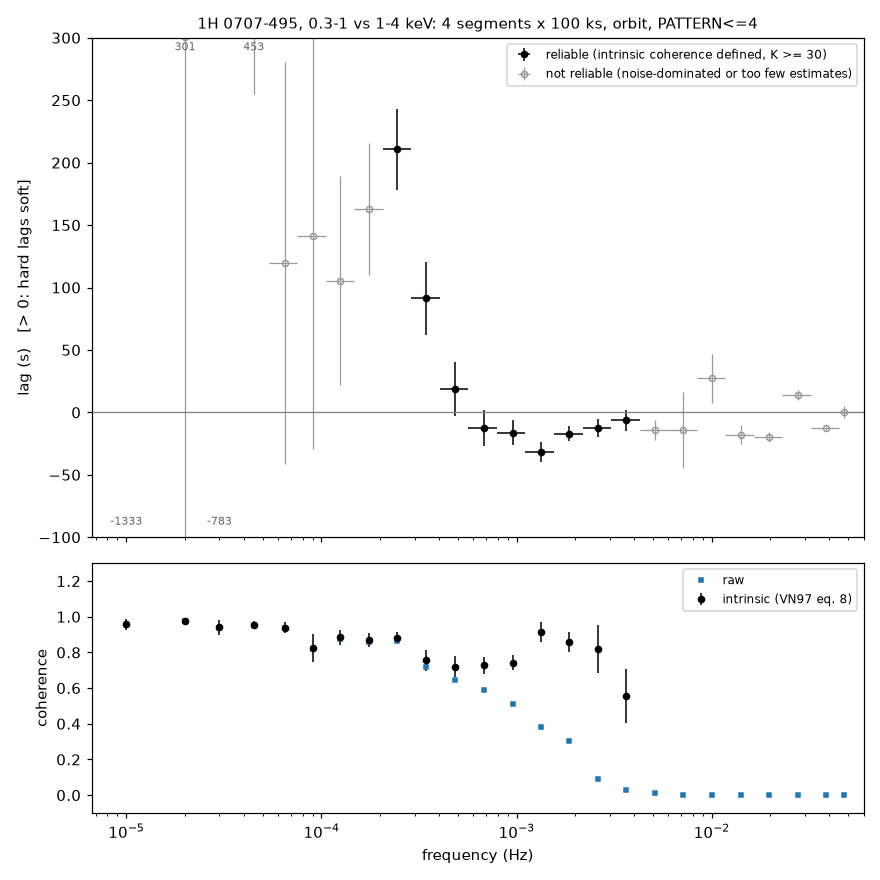
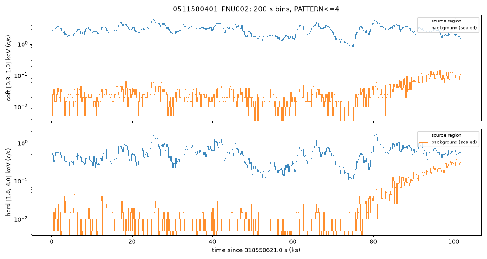

# R1: lag–frequency spectrum of 1H 0707–495 (Fabian et al. 2009, Fig. 3)

| Check ([what these mean](../docs/METHODOLOGY.md#levels-of-checking)) | Status |
|---|---|
| Computed by the explainer | **done** (2026-11-19) |
| Re-run by a verifier | **matched** at `9eea9a1` (2026-11-19, Grok 4.7 High Fast in Cursor: [report](../verification/2026-11-19-grok-4.7-high-fast/REPORT.md), [#2](https://github.com/phajy/Retrace/issues/2)) |
| Re-derived by a verifier | not yet |
| Compared with the paper | not yet (needs digitised Fig. 3 points) |
| Challenges | [#1](https://github.com/phajy/Retrace/issues/1) background flares: **confirmed** ([result](checks/issue-1/RESULT.md)) · [open another](https://github.com/phajy/Retrace/issues/new?template=check-request.yml) |

**This is not yet a reproduction claim.**

## The published claim
Fabian et al. 2009 (F09; *Nature* 459, 540; arXiv:0905.4383), Fig. 3, shows the time lag between the
0.3–1 keV (soft) and 1–4 keV (hard) X-ray bands as a function of Fourier frequency. It uses four
consecutive XMM-Newton orbits observed in early 2008 (about 500 ks in total). The paper reports that above about 0.6 mHz (caption: 7×10⁻⁴ Hz)
"the soft band follows the hard band by about 30 s", and that at lower frequencies the lag has the opposite sign.

**Sign convention** (same as F09 Fig. 3): lag > 0 means the hard band lags the soft band. lag < 0 means
the soft band lags the hard band.

## Our result (current baseline)

Filled black points are reliable bins. Open grey points are not reliable, because the signal is too
close to the noise or too few independent estimates were averaged (assumption A-13). Values off the
top or bottom of the plot are printed next to the axis.

| Fact | Value |
|---|---|
| Frequency range of reliable bins | 2.45×10⁻⁴ – 3.66×10⁻³ Hz |
| Lag at 2.45×10⁻⁴ Hz | +211 ± 32 s (hard lags soft) |
| Weighted mean, reliable bins in 1×10⁻⁴ – 5×10⁻⁴ Hz | +81 ± 15 s (3 bins) |
| Frequency where the lag changes sign | 5.9×10⁻⁴ Hz |
| Most negative reliable bin | −31.7 ± 8.1 s at 1.34×10⁻³ Hz (soft lags hard) |
| Weighted mean, reliable bins in 7×10⁻⁴ – 5×10⁻³ Hz | −16.8 ± 3.4 s (5 bins) |
| Intrinsic coherence | 0.72–0.98 from 10⁻⁵ to 2.6×10⁻³ Hz |

**Descriptive comparison only** (the formal comparison is the planned `compare` stage). The shape and
sign match F09's description: positive at low frequency, negative above about 0.6 mHz. Our most negative
bin is consistent with "about 30 s". Our mean over 0.7–5 mHz is smaller in magnitude. F09 does not say
whether its "about 30 s" is a peak or an average, or over which range.

## How it was made (short version)
Four XMM-Newton EPIC-pn exposures, one 100 ks window per orbit, 10 s bins, background-subtracted light
curves, averaged cross-spectrum with geometric frequency bins (factor 1.4), and lag errors from
Nowak et al. 1999. The method follows Zoghbi et al. 2010 (arXiv:0910.0367), which describes how its
version of this figure was made. Full details:
* [filter stage](../reduction/filter/EXPLAIN.md), [light-curve stage](../analysis/lightcurves/EXPLAIN.md),
  [lag stage](../analysis/lags/EXPLAIN.md)
* [assumptions register](../docs/assumptions.md): A-06 to A-13 matter most here

## The explainer's own checks (not independent)
| Check | Result | Evidence |
|---|---|---|
| Sign and units: synthetic light curves with the hard band delayed by +30 s | recovers +29.8 s, **passed** (runs every time) | `self_test_sign` in [`summary.json`](../analysis/lags/summary.json) |
| Independent library: Stingray 2.3.2 on the same segments | same lag at every frequency (max difference 4×10⁻¹³ s), **passed** (runs every time) | `stingray_cross_check` in `summary.json` |
| Determinism: forced re-run on the same machine | all output checksums unchanged | [`LOG.md`](../docs/LOG.md) |
| Red-noise leakage diagnostic (reported, not pass/fail) | recovers 0.92 of an injected lag for a steep power spectrum | assumption M-02 |

## Known concerns (in priority order)
1. **End-of-orbit background flares inside the windows** of obs 0301 and 0401. Near the end of 0401 the
   scaled background reaches about half the source rate in the hard band (orange curve, lower panel):
   
   Background subtraction removes this to first order, but a scaling error would leave flare
   variability in the light curves. See also the flare screen for
   [0401](figures/diag_0511580401_PNU002.png) and [0301](figures/diag_0511580301_PNU002.png).
   **Tested in [check request #1](checks/issue-1/RESULT.md):** with background subtraction switched off, which leaves
   the flares fully in, no reliable bin moves by more than 0.34σ. Outcome: confirmed. A test with flare-free windows
   is still possible but no longer a priority.
2. **PATTERN ≤ 12** for timing (Zoghbi et al. 2010 say patterns were relaxed for timing; we use ≤ 4, A-07).
3. **Frequency binning** factor 1.4 vs 2.4 (A-11: the source text is ambiguous).
4. **What "about 30 s" means** (peak or average; which frequency range).

## Provenance
The numbers on this page were copied by hand from [`analysis/lags/summary.json`](../analysis/lags/summary.json)
and [`analysis/lags/lag_frequency.csv`](../analysis/lags/lag_frequency.csv). Those outputs were produced at
commit `b60e201` and have not changed since. Their checksums in [`dvc.lock`](../dvc.lock) are
`summary.json` md5 `269f66aa…` and `lag_frequency.csv` md5 `65575e5c…`. An independent re-run at `9eea9a1`
produced the same checksums ([#2](https://github.com/phajy/Retrace/issues/2)). If `dvc.lock` shows different
values, this page is out of date and the JSON and CSV files are authoritative.
