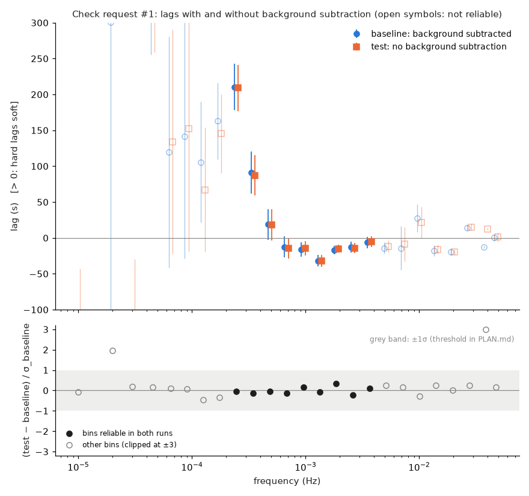

# Check request #1: result

Issue: https://github.com/phajy/Retrace/issues/1 · plan: [`PLAN.md`](PLAN.md) (posted to the issue before the run,
2026-11-19 22:13 UTC) · commit checked: `9eea9a1` · explainer: Claude Opus 5.5 in Claude Code.

**Outcome: no significant change, by the criteria fixed in the plan. `outcome: confirmed`.** Switching background
subtraction off, which leaves the whole background in the light curves (end-of-orbit flares included), moves no
reliable bin by more than 0.34σ.

## What was run
```bash
dvc exp run --temp -n issue-1-no-bkg-subtraction -S lags.background_subtract=false   # on 9eea9a1
python results/checks/issue-1/compare.py                                             # applies the plan's criteria
```
* The experiment changed exactly one parameter, `lags.background_subtract` (true → false). This was checked by
  comparing the parsed `params.yaml` of the experiment commit with `9eea9a1`. DVC's `-S` option also rewrote the
  file's layout, but no other value changed. Only the lags stage re-ran.
* Its sign self-test and Stingray cross-check both passed.
* The experiment's outputs are copied here: [`test_summary.json`](test_summary.json),
  [`test_lag_frequency.csv`](test_lag_frequency.csv), [`test_lag_frequency.png`](test_lag_frequency.png).
  The full comparison is in [`comparison.json`](comparison.json).

## Results against the criteria
| Item | Baseline (subtracted) | Test (not subtracted) | Change | Criterion | Triggered? |
|---|---|---|---|---|---|
| 1. Mean lag, 0.7–5 mHz | −16.8 ± 3.4 s | −15.9 ± 3.3 s | +0.9 s (+0.28σ) | > 1σ | no |
| 2. Mean lag, 0.1–0.5 mHz | +81.5 ± 15.3 s | +80.4 ± 15.2 s | −1.1 s (−0.07σ) | > 1σ | no |
| 3. Sign change | 5.95×10⁻⁴ Hz | 5.85×10⁻⁴ Hz | same pair of bins | different pair | no |
| 4. Most negative bin (1.34 mHz) | −31.7 ± 8.1 s | −32.2 ± 8.2 s | −0.5 s (−0.06σ) | (item 5) | no |
| 5. Each bin reliable in both runs (9 bins) | | | largest +0.34σ (1.86 mHz) | > 1σ | no |

The same 9 bins are reliable in both runs.



**Outside the criteria (reported for completeness).** Two bins that are unreliable in both runs move by more
than 1σ:
* At 2×10⁻⁵ Hz: +301 ± 459 s becomes +1206 ± 623 s (+2.0σ). Here K = 4, so there are too few estimates.
* At 3.9×10⁻² Hz: −12.9 ± 1.6 s becomes +12.3 ± 1.6 s. This is the bin quoted in `analysis/lags/EXPLAIN.md` as the
  example of an invalid analytic error at the noise floor, when the reliability flag (A-13) was added. A sign flip
  with an unchanged "±1.6 s" is consistent with that flag: at the noise floor the analytic errors mean nothing.

## What this does and does not show
* **Shows (fact):** for the baseline choices, the lag–frequency spectrum in the reliable range (2.45×10⁻⁴ –
  3.66×10⁻³ Hz) is insensitive to whether the background is subtracted. The background, flares included,
  does not affect R1 at the 1σ level.
* **Why that also covers the leftover after subtraction (reasoning, stated in the plan):** subtraction removes most
  of the background. What it leaves is smaller than the full background, unless the background scaling were wrong
  by more than a factor of 2.
* **Context (fact, from `analysis/lightcurves/summary.json`):** averaged over each exposure, the scaled background is
  about 1% of the source rate in 0.3–1 keV and 2.5–7.5% in 1–4 keV. The flares are large only at the ends of
  orbits 0301 and 0401.
* **Does not show:** anything about choices other than background subtraction. In particular it does not test
  segment length, PATTERN selection or frequency binning (open assumptions A-07, A-09, A-11).

## Baseline
Unchanged, as the plan specified for this outcome. Assumption A-08 now records this test.
