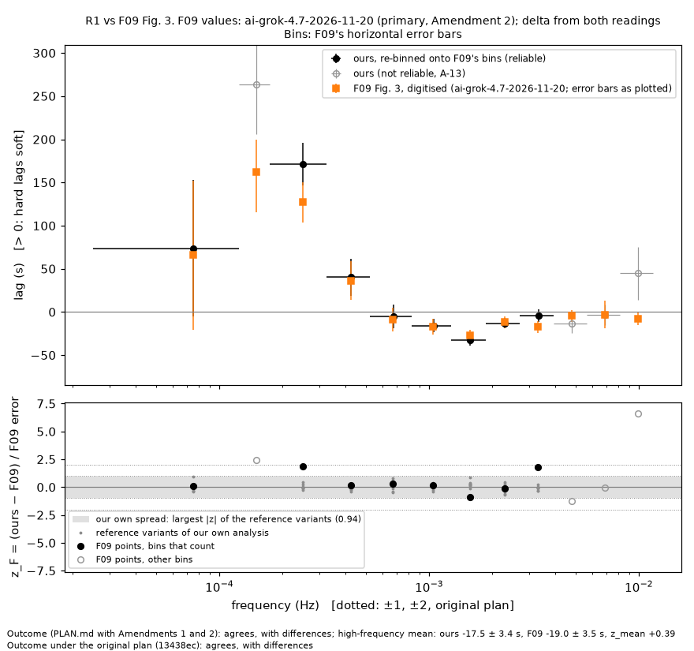

# R1 compared with Fabian et al. 2009, Fig. 3: result

Check: **Compared** ([definition](../../docs/METHODOLOGY.md#levels-of-checking)), run by the explainer (Claude Opus 5.5
in Claude Code) on 2026-11-20 with the `compare` DVC stage. Plan and criteria: [`PLAN.md`](PLAN.md), with Amendments 1
and 2. F09 = Fabian et al. 2009, *Nature* 459, 540 (arXiv:0905.4383).

**The explainer's run is not independent.** The explainer also computed R1, wrote the plan and the comparison code,
and proposed both amendments. The independent inputs are the two digitisations. **An independent verifier has since
written its own comparison code from [`PLAN.md`](PLAN.md)** (Grok 4.7 High Fast in Cursor, at `9cb723d`,
[report](../../verification/2026-11-20-grok-4.7/REPORT.md), [#6](https://github.com/phajy/Retrace/issues/6)). It got the same outcome under Amendment 1, under the
original rule and in the two sensitivity variants it ran, with the same two bins outside our own spread. Its z_F values
agree with ours to 0.001 on the bins that count.

## Outcome: agrees, with differences
* **The summary numbers that F09's text states agree.**
  * Over 0.7–5 mHz, the weighted mean lag is −17.5 ± 3.4 s for us and −19.0 ± 3.5 s for F09's points:
    z_mean = +0.39, within the limit of 1.
  * The lag changes sign between the same pair of F09's bins in both: at 6.4×10⁻⁴ Hz for us and 6.1×10⁻⁴ Hz for F09.
  * No bin has lags of opposite sign that are both more than 2σ from zero.
* **Bin by bin, two of the eight bins that count differ by more than our own reference variants do.** Bin 3
  (1.7–3.2×10⁻⁴ Hz) differs by +1.88 of F09's error bars, and bin 9 (2.7–3.9×10⁻³ Hz) by +1.78. Our reference
  variants move no bin by more than 0.94 on these bins. Over the eight bins, the rms of z_F is 0.98, against 0.44
  for our variants. In both bins our lag is the more positive one.
* **The original rule** (plan `13438ec`, before the amendments) gives the same outcome, for the same two bins:
  every |z_F| ≤ 2, and two are between 1 and 2.
* **The sensitivity variants give the same outcome:** the mean of both digitisations, and each digitisation on its
  own. The ±¼-bin edge shift does not apply, because F09 drew horizontal error bars.
* **The error bars are similar:** our error divided by F09's has a median of 0.97 (the plan's range is 0.67–1.5).

This is a comparison with the published figure. It is not a reproduction claim: R1 has been re-run by a verifier, and a
verifier's re-derivation differs from it by 0.10–0.16 of 1σ in two bins and the high-frequency mean, under that
verifier's own criterion ([score sheet](../SCORESHEET.md)).

*Top: our lag on F09's bins (black: reliable; grey: not reliable, A-13) and F09's digitised points (orange). Bottom:
z_F = (ours − F09) / F09's error for each bin. The grey band is our own spread (the largest |z| of the reference
variants); the grey dots are the reference variants; the dotted lines are the original plan's limits of ±1 and ±2.*

## Bin by bin
F09's bins are the ends of its horizontal error bars (A-15). F09's values are from the vector reading of the PDF
(A-20); δ, the digitisation uncertainty, is 1.25 s for every point.

| Bin | F09 bin (Hz) | F09 lag (s) | Our lag (s) | z_F | Counts? |
|---|---|---|---|---|---|
| 1 | 2.49×10⁻⁵ – 1.25×10⁻⁴ | +65.7 ± 86.2 | +73.7 ± 79.2 | +0.09 | yes |
| 2 | 1.25×10⁻⁴ – 1.74×10⁻⁴ | +162.2 ± 42.2 | +263.5 ± 57.4 | (+2.40) | no: K = 20 < 30 (A-13) |
| 3 | 1.74×10⁻⁴ – 3.24×10⁻⁴ | +127.0 ± 23.6 | +171.5 ± 24.5 | **+1.88** | yes |
| 4 | 3.24×10⁻⁴ – 5.23×10⁻⁴ | +36.3 ± 22.4 | +40.4 ± 21.4 | +0.18 | yes |
| 5 | 5.23×10⁻⁴ – 8.22×10⁻⁴ | −9.1 ± 13.8 | −5.2 ± 13.5 | +0.28 | yes |
| 6 | 8.22×10⁻⁴ – 1.27×10⁻³ | −17.1 ± 8.9 | −15.8 ± 8.0 | +0.15 | yes |
| 7 | 1.27×10⁻³ – 1.87×10⁻³ | −27.1 ± 6.3 | −32.9 ± 6.2 | −0.90 | yes |
| 8 | 1.87×10⁻³ – 2.72×10⁻³ | −11.9 ± 6.9 | −13.0 ± 6.0 | −0.15 | yes |
| 9 | 2.72×10⁻³ – 3.91×10⁻³ | −17.3 ± 7.0 | −4.7 ± 7.3 | **+1.78** | yes |
| 10 | 3.91×10⁻³ – 5.66×10⁻³ | −4.6 ± 7.1 | −13.6 ± 10.4 | (−1.26) | no: coherence not measurable (A-13) |
| 11 | 5.66×10⁻³ – 8.15×10⁻³ | −2.9 ± 15.9 | −3.2 ± 12.0 | (−0.02) | no: coherence not measurable (A-13) |
| 12 | 8.15×10⁻³ – 1.17×10⁻² | −7.7 ± 7.8 | +44.7 ± 30.3 | (+6.63) | no: coherence not measurable (A-13) |

Errors are ±1σ (F09's taken as ±1σ, A-16; its bars are not described in the paper). z_F = (ours − F09) / √(S² + δ²),
where S is F09's error. Values in brackets are shown but do not decide the outcome.
* **Bin 2:** F09's upper error bar ends on the top of the plot frame (200 s), so its error is too small and its z_F
  too large. The bin cannot count in any case.
* **Bin 12:** our value is far from F09's, but the noise swamps the signal there (as in R1 above about 4×10⁻³ Hz),
  so it is not reliable.

## Our own spread on F09's bins
The reference variants (A-19), each against our baseline, over the eight bins that count:

| Variant | rms z | largest \|z\| |
|---|---|---|
| Edges moved −0.10, −0.05, +0.05, +0.10 bin | 0.22, 0.19, 0.28, 0.43 | 0.34, 0.38, 0.59, 0.87 |
| One 95, 90, 80 ks window per orbit | 0.27, 0.40, 0.44 | 0.44, 0.77, 0.94 |
| 100 ks window at the end of the usable stretch | 0.26 | 0.56 |
| **Limits** (largest of the above) | **0.44** | **0.94** |
| **F09's points** | **0.98** | **1.88** |

## Side results
* **A-11 (frequency bin factor).** The ratio between consecutive F09 point frequencies falls steadily from 2.0 at the
  lowest frequencies to 1.44 at the highest. It is not one constant ratio: a fit gives 1.54, with a scatter of
  0.06 dex. So the ratio is not clear in the plan's sense, and A-11 stays at 1.4. At high frequency F09's spacing
  (1.44) is closer to 1.4 than to the literal reading of Zoghbi et al. 2010 (2.4).
* **What "about 30 s" refers to.** F09's own points average −19.0 ± 3.5 s over 0.7–5 mHz, and the most negative one
  is −27.1 ± 6.3 s, at 1.6×10⁻³ Hz. F09's "about 30 s" is closer to its most negative point than to its average over
  this range.
* **F09's frequency grid.** The low-frequency edges of F09's bins sit on multiples of about 2.49×10⁻⁵ Hz (1, 5, 7, 13
  and 21 times it). Our Fourier frequencies are 10⁻⁵ Hz apart. This suggests that F09 used segments of about 40 ks
  rather than 100 ks (A-09).
* **χ² with the combined error,** reported for completeness only (too lenient, because the photons are shared): 3.7
  for 8 bins (p = 0.88).

## What this shows, and what it does not
* **Facts:** our lags agree with F09's in the quantities its text states (the high-frequency lag and where the sign
  changes), and in six of the eight bins that count, to within the spread that binning and segmentation choices
  produce. In two bins the difference is 1.8–1.9 of F09's error bars, larger than that spread but within the
  original plan's limit of 2.
* **Not shown:** why bins 3 and 9 differ. Choices outside the reference variants could do it, for example:
  * the data reduction (M-01: archive event lists and our own filtering, not SAS 8; A-07: PATTERN ≤ 4 or ≤ 12;
    A-05: the flare screen);
  * a different segment length, as F09's frequency grid suggests.

  None of these has been tested against F09's points yet. Under the plan they can be explored only as sensitivity
  tests reported next to this result, and the baseline does not change because of this comparison.
* **How the plan was followed** (details in [PLAN.md](PLAN.md#what-actually-happened)):
  * The original plan was committed before any digitising.
  * The comparison code and Amendment 1 were committed after both digitisations had been committed, but before the
    explainer had seen any digitised value.
  * Amendment 2 was decided after the agreement check and before this run.
  * The AI digitiser was not blind to our result. Its reading is a scripted extraction from the PDF, and it agrees with
    the maintainer's independent reading to 0.35 s.
  * The original rule gives the same outcome as the amended one, and so do all the sensitivity variants. So neither
    amendment changed the outcome.
* **Changed after the run, presentation only:** the figure's title, its y-range (so that our unreliable value in
  bin 2 is not off the top) and its footer. No number changed.

## Provenance
* **Run:** the `compare` stage, on `main` after merging the two digitisations (`b770923`). The digitisations are
  `ai-grok-4.7-2026-11-20` (vector reading, `7f0853a`) and `ay` (WebPlotDigitizer, `95d1a75`).
* **Numbers:** copied by hand from [`comparison.json`](comparison.json) (md5 `5461463fe6889b2cbb4a8c12ef598060`) and
  [`comparison.csv`](comparison.csv) (md5 `6bc0c54a6610bfd789ca9ead36e8bf48`), as recorded in `dvc.lock`.
* **Input checksums** are listed in `comparison.json` under `inputs`.
* If `dvc.lock` shows different checksums for these files, this page is out of date and the JSON and CSV files are
  authoritative.
